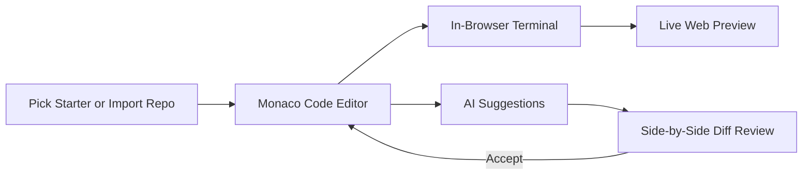

<div align="center">


# PoiEx

**A full code editor and dev environment in your browser tab. No installs, no remote servers, just code.**

<p align="center">
  
  
  
  
</p>

</div>

---

## What is PoiEx?

Think of having VS Code, a terminal, and a live web preview tucked inside a single browser tab. You open a page, and you have a working development workspace ready to go.

Most online IDEs spin up a virtual machine on a remote server, charge you for compute hours, and host your files on their cloud. PoiEx works differently: everything runs on your own device inside the browser using WebAssembly. Your packages install in browser memory, your local server starts in the tab, and your preview updates in real time.

AI assistance is built to respect your control and privacy. You can connect a local Ollama model for fast, private code autocompletions that never send keystrokes to the internet. Or you can connect Gemini or Groq for code reviews and debugging. When AI suggests code, you inspect it in a visual side-by-side diff before anything is saved. And if you prefer coding without AI, turn it off with one click.

---

## How it works



The core engine is WebContainers, a WebAssembly technology that runs a real Node.js operating system directly inside the browser. Because your code runs on your own machine instead of a remote VM, there are zero server compute bills and your code stays private.

---

## Highlights

- **Browser-native runtime**: Runs real Node.js and npm packages using WebContainers. No local setup or remote VMs required.
- **Real interactive terminal**: A full bash shell with command history, clear, search, and package installation.
- **Side-by-side diff review**: When AI suggests changes, you inspect the exact additions and deletions before clicking Accept or Reject.
- **Terminal error fixes**: One click on "Explain & Fix with AI" when an npm command or dev server errors out feeds the logs to the assistant.
- **GitHub import**: Connect your GitHub account to import your repositories and forks with one click, or paste any public repository link.
- **Non-Node repo support**: Python, Go, Rust, or plain docs open smoothly in Editor Mode for browsing and editing.
- **Client-side ZIP export**: Download your entire project as a `.zip` archive anytime directly from the browser, with no server round-trip.
- **Private local AI**: Runs offline Fill-In-The-Middle completions via Ollama, with cloud fallbacks to Groq and Gemini.

---

## Starters

| Template | What it is good for |
|---|---|
| Next.js | Full-stack applications with server components and routing |
| React | Frontend single-page apps and UI component experiments |
| Express | Node.js backend APIs and web servers |
| Hono | Fast, lightweight APIs following web standards |
| Vue | Reactive frontend applications with Vue 3 |
| Angular | Structured, modular frontend development |
| Editor mode | Python, Go, Rust, static websites, or any repo you want to inspect and edit |

---

## Getting started

You only need Node.js and a MongoDB database (like a free MongoDB Atlas cluster). Everything else is optional.

### 1. Clone and install

```bash
git clone https://github.com/d-souptik24/poiex.git
cd poiex
npm install
```

### 2. Set up environment variables

Copy the example configuration:

```bash
cp .env.example .env
```

Add your values in `.env`:
- `DATABASE_URL` (MongoDB Atlas connection string)
- `AUTH_SECRET` (generate one with `openssl rand -base64 32`)
- Optional OAuth credentials (`AUTH_GITHUB_ID`, `AUTH_GITHUB_SECRET`, `AUTH_GOOGLE_ID`, `AUTH_GOOGLE_SECRET`)
- Optional AI keys (`OLLAMA_BASE_URL` for local models, or `GEMINI_API_KEY` / `GROQ_API_KEY` for cloud)

### 3. Initialize the database

```bash
npx prisma db push
```

### 4. Start developing

```bash
npm run dev
```

Open [http://localhost:3000](http://localhost:3000) in your browser.

---

## AI options

PoiEx works without any AI keys configured. You get the complete editor, file manager, terminal, preview, and GitHub import out of the box.

If you choose to use AI:
- **Local Ollama**: Fast inline ghost-text completions that run 100% on your machine (`qwen2.5-coder:1.5b-base`).
- **Cloud models (Gemini / Groq / OpenRouter)**: Enables chat, code reviews, time and space complexity audits, and one-click terminal error fixes.

---

<div align="center">

Crafted by **[Souptik Dutta](https://github.com/d-souptik24)**

[Project Repository](https://github.com/d-souptik24/poiex) · [Report an Issue](https://github.com/d-souptik24/poiex/issues) · [MIT License](./LICENSE)

</div>
